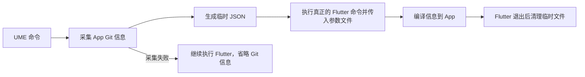
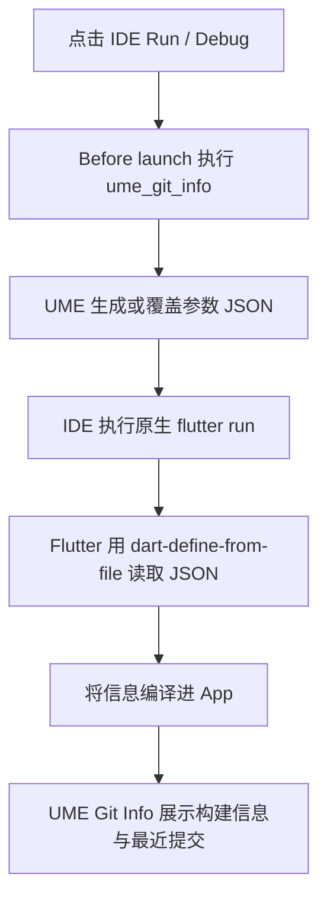

# ume_kit_git

[English](./README.md)

UME 的独立 Git 构建信息插件。面板、Git 采集和命令行工具均由本包提供，
只依赖 Flutter 和 `ume_core`，不依赖 `ume_kit_device`。

本文描述当前仓库源码中的功能；使用本地或 Git 依赖时，请使用包含本包及 CLI 的同一份源码。
仓库中的版本号不表示同版本的 pub.dev 归档已经包含这些新增功能。

## 展示内容

| 区域 | 内容 |
| --- | --- |
| 当前构建 | 完整 commit ID、分支、完整提交说明、作者、提交时间、工作区是否有未提交修改 |
| 最近提交 | 最多 5 条记录，默认折叠；显示短 ID、提交摘要、作者和时间 |
| 复制 | 点击当前构建字段可复制该字段；点击提交记录或复制按钮可复制完整 ID 和提交详情 |

时间采用 Git committer time，保留时区；“作者”来自 Git author name。
最近提交包含当前构建 commit，按 `git log -5` 顺序排列，不足 5 条时显示实际数量。
当前实现固定最多 5 条，没有配置条数的命令行参数。

信息来自执行命令的 **App 仓库本地 HEAD**，不是 UME 仓库，也不是远端最新提交。
未提交修改仅记录状态，不保存差异；最近提交不能替代相邻两个测试包之间的完整变更记录。

## 注册面板

已依赖完整 UME 的项目，在初始化插件时增加：

```dart
import 'package:ume/ume.dart';

PluginManager.instance.register(const GitInfo());
```

仅使用这个 kit 时，导入：

```dart
import 'package:ume_core/ume_core.dart';
import 'package:ume_kit_git/ume_kit_git.dart';

PluginManager.instance.register(const GitInfo());
```

然后按 UME 的方式用 `UMEWidget` 包裹 App。插件注册负责显示入口；
下面的采集步骤负责提供数据，两者都需要配置。

本地独立接入示例（按实际检出位置调整路径）：

```yaml
dev_dependencies:
  ume_kit_git:
    path: ../ume/packages/ume_kit_git

dependency_overrides:
  ume_core:
    path: ../ume/packages/ume_core
```

执行 `flutter pub get`。App 与 UME 仓库不需要加入同一个 pub workspace。

## 两种接入流程

| 场景 | 命令 | JSON 文件生命周期 |
| --- | --- | --- |
| 终端启动、测试、打包 | `dart run ume:flutter …` | UME 生成系统临时文件，Flutter 退出后删除 |
| IDE 断点调试、原生 Flutter 命令 | 先执行 `dart run ume:git_info`，再由 Flutter 读取文件 | 默认写入 `.dart_tool/ume_git_info.json`，每次启动前覆盖更新 |

两种方式共用同一个采集实现。请在 App 项目目录执行；电脑需要 Git、Dart、Flutter，
并使用与项目一致的 Flutter SDK。安装后的 App 无需 Git、网络或电脑上的 JSON 文件。

只依赖本 kit 时，将命令替换为：

| 完整 UME 入口 | 独立 kit 入口 |
| --- | --- |
| `dart run ume:flutter …` | `dart run ume_kit_git:flutter …` |
| `dart run ume:git_info [output.json]` | `dart run ume_kit_git:generate_git_info [output.json]` |

这里 `dart run ume:flutter` 表示执行 `ume` 包的 `bin/flutter.dart`，
随后由它调用真正的 Flutter；不是 Flutter 自带的子命令。

### 终端和打包脚本

将原命令中的 `flutter` 替换为 `dart run ume:flutter`，其余参数照常传递：

```sh
dart run ume:flutter run --flavor dev -t lib/main_dev.dart
dart run ume:flutter build apk --release --flavor dev -t lib/main_dev.dart
dart run ume:flutter build ipa --release --flavor dev -t lib/main_dev.dart
dart run ume:flutter test
```

flavor 和入口文件使用项目实际名称；未使用 flavor 的项目省略对应参数。
`run`、`build`、`test` 自动注入 Git 信息，其他命令与帮助请求原样转交 Flutter。
工具保留终端输入输出和 Flutter 退出码，macOS/Linux 也会转发终止信号。



### Android Studio / IntelliJ

保留 IDE 原生的 Flutter 运行配置，断点调试与热重载继续由 IDE 管理。

1. 打开 **Run → Edit Configurations**，点击左上角 `+` → **Shell Script**。
2. 新建运行任务，配置如下：

| 配置项 | 内容 |
| --- | --- |
| Name | `ume_git_info` |
| 执行方式 | **Script text** |
| Script text | `dart run ume:git_info` |
| Interpreter path | macOS/Linux：`/bin/sh` |
| Working directory | `$ProjectFileDir$`（App 根目录） |
| Execute in terminal | 不勾选，让 IDE 等待任务结束并读取退出码 |

如果 IDE 的 PATH 找不到 Dart，用实际 Flutter SDK 中的 Dart 绝对路径替换 `dart`，
例如 `/path/to/flutter/bin/dart run ume:git_info`。Windows 可使用对应的脚本运行任务，
解释器和 Dart 可执行文件路径按本机安装调整。

3. 选中 App 的 Flutter 启动配置，在 **Additional run args** 中追加：

```text
--dart-define-from-file=.dart_tool/ume_git_info.json
```

保留原来的 `--debug` / `--release`、flavor 和入口文件。

4. 在 **Before launch** 中点击 `+` → **Run Another Configuration**，选择 `ume_git_info`。
5. 确认列表中出现 `Run 'ume_git_info'`，然后 **Apply → OK**。每个需要 Git 信息的启动配置都要关联一次。

这里选择的是项目内的运行任务，不需要另外创建全局 External Tool。



### VS Code / Cursor

将以下任务合并到 `.vscode/tasks.json`，保留已有任务：

```json
{
  "version": "2.0.0",
  "tasks": [{
    "label": "UME Git Info",
    "type": "process",
    "command": "dart",
    "args": ["run", "ume:git_info"],
    "options": {"cwd": "${workspaceFolder}"},
    "problemMatcher": []
  }]
}
```

在 `.vscode/launch.json` 的目标配置中增加 `preLaunchTask` 和 `toolArgs`：

```json
{
  "version": "0.2.0",
  "configurations": [{
    "name": "App with UME Git Info",
    "type": "dart",
    "request": "launch",
    "program": "lib/main.dart",
    "preLaunchTask": "UME Git Info",
    "toolArgs": ["--dart-define-from-file=.dart_tool/ume_git_info.json"]
  }]
}
```

按实际项目保留入口、flavor、设备和其他启动参数；这些示例可以直接使用，不需要修改 UME。

### 原生 Flutter / 自定义输出路径

```sh
dart run ume:git_info
flutter run --dart-define-from-file=.dart_tool/ume_git_info.json

# 自定义路径：生成和读取必须使用同一个文件。
dart run ume:git_info .dart_tool/custom_git_info.json
flutter build apk --dart-define-from-file=.dart_tool/custom_git_info.json
```

不要把 Git 命令写进 App 运行时代码。移动设备没有开发电脑的仓库，
编译时的 `String.fromEnvironment` 也不会在热重载时重新读取电脑上的文件。

## 失败处理和兼容行为

| 情况 | 结果 |
| --- | --- |
| 无 Git、目录不是仓库、仓库还没有提交等采集错误 | 输出提示，继续启动或构建 |
| IDE 采集失败 | 用 `{}` 覆盖旧 JSON 并返回成功，Flutter 仍可读取参数文件 |
| 包裹命令采集失败 | 继续调用 Flutter，不注入本次 Git 信息 |
| IDE 参数文件无法写入等 I/O 错误 | 报告失败，避免把旧文件当成本次信息；需修复目录权限或路径 |
| Flutter 自身构建失败 | 保留 Flutter 的失败退出码 |
| 未注入当前构建信息 | 面板显示“暂无 Git 信息”，不展示 Git 字段和最近提交 |
| 旧安装包缺少历史字段、历史数据格式损坏 | 当前构建字段仍可显示，省略最近提交列表 |

## 图标与资源

Git 插件图标使用内置 Base64 字节和 `MemoryImage`，与 UME 多数插件一致。
业务方不需要在 `pubspec.yaml` 中声明图片路径，即使 UME 位于 `dev_dependencies` 也可显示。
`assets/git_icon.png` 保留为原始图标来源，不参与运行时 asset 加载。

## 常见问题

- **更新代码后仍显示旧提交？** 每次重新 Run / Debug 或打包前重新采集。热重载、热重启都不会重新运行采集命令并重新编译 dart-define；需要完整停止后重新运行。
- **Before launch 还是空的？** 确认已用 **Run Another Configuration** 选择项目任务并点击 Apply；仅有 JSON 参数或 Shell Script 任务还不够。
- **找不到 JSON？** 确认采集任务的工作目录是 App 根目录、任务已执行，且生成和读取路径一致。默认 `.dart_tool/` 通常已在 Flutter 项目的 `.gitignore` 中。
- **最近提交不足 5 条？** 本地历史或 CI 的浅克隆可能不足。若 CI 需要完整历史，配置 checkout 的 `fetch-depth: 0`；UME 不会自动联网 fetch。
- **为什么同一个 commit 仍标记未提交修改？** 状态包括 Git 检测到的已跟踪修改与未跟踪文件。自定义 JSON 输出路径应加入忽略规则，避免生成物影响后续状态。
- **Release/Profile 能使用吗？** Git 面板读取编译期数据，不依赖 VM Service；仍需在对应内测入口注册 `GitInfo` 并包裹 UME，只有 `kDebugMode` 分支注册时不会出现在 release 包中。

## 开发验证

在仓库根目录执行：

```sh
flutter pub get
dart analyze packages/ume_kit_git packages/ume/bin
flutter test packages/ume_kit_git/test
```

验证带真实构建信息的面板交互，可在仓库根目录执行：

```sh
dart run ume:flutter test packages/ume_kit_git/test/git_info_test.dart
```

测试覆盖 Git 历史顺序与数量、中文信息、采集失败继续执行、旧文件清理、
参数和退出码转发、临时文件生命周期、折叠与复制、图标解码。


## 采集可靠性与 SDK 选择补充

- Git 采集改为异步，所有命令共用默认 5 秒预算。采集失败或超时后继续执行 Flutter；历史采集失败时只省略最近提交，保留当前构建信息。
- 当前提交字段合并读取，正常采集从 7 次 Git 调用减少为 4 次。
- IDE 生成器先在目标文件旁暂存 JSON，再原子替换。采集失败仍用 `{}` 覆盖旧数据；文件写入失败仍返回非零退出码。临时文件清理失败仅输出警告，不覆盖原始执行结果。
- 支持在 `run`、`build`、`test` 前传入全局 Flutter 参数，例如 `dart run ume:flutter --verbose run`。
- Flutter SDK 选择顺序：环境变量 `UME_FLUTTER_EXECUTABLE` 指定的可执行文件路径 → 当前 Dart SDK 所属 Flutter → PATH 中的 `flutter`。需要指定其他 SDK 时可设置该环境变量。
- 直接调用 Dart API 时，现在需要 `await captureGitInfo()`、`await generateGitInfo(args)`；`captureGitInfo(timeout: Duration(seconds: 5))` 可自定义总预算。原有 CLI 命令不变。
- 最近提交按时间、提交说明、短 commit 号和提交人三行展示；复制内容仍包含完整 commit 号。


## 此前提交（最新行为说明）

历史区域文案改为“此前提交”，提示“不含当前构建，最多 5 条”。采集使用 `git log -5 --skip=1 <构建commit>`，排除当前构建 commit，展示它之前最多 5 条提交；此说明替代前文包含当前构建 commit 的旧规则。历史不足时显示实际数量，只有一个 commit 时不展示历史区域。顶部当前构建详情保持不变。
